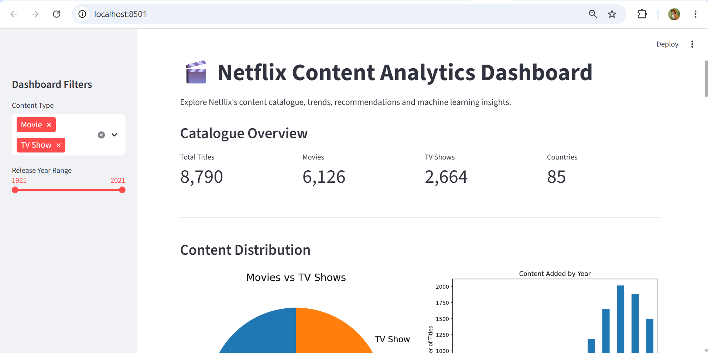
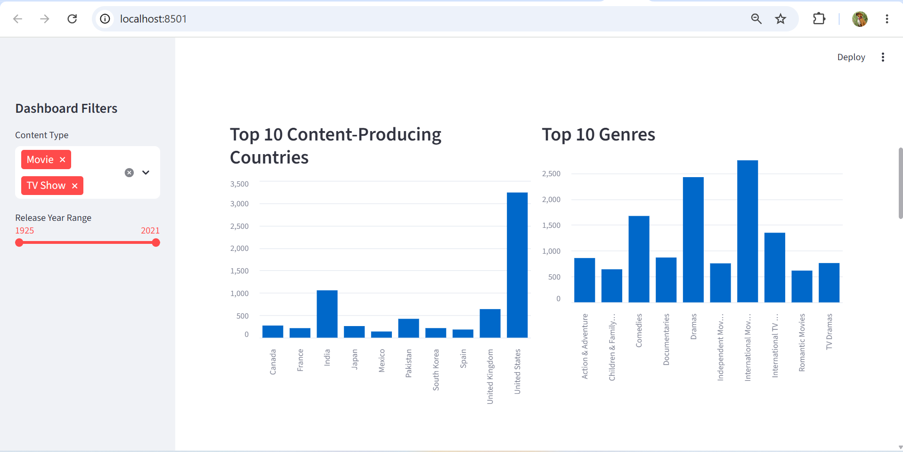
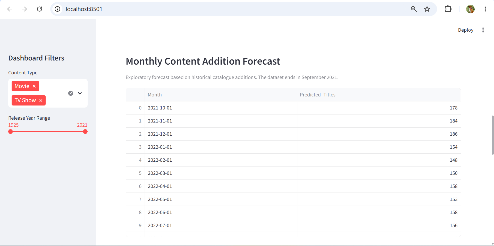
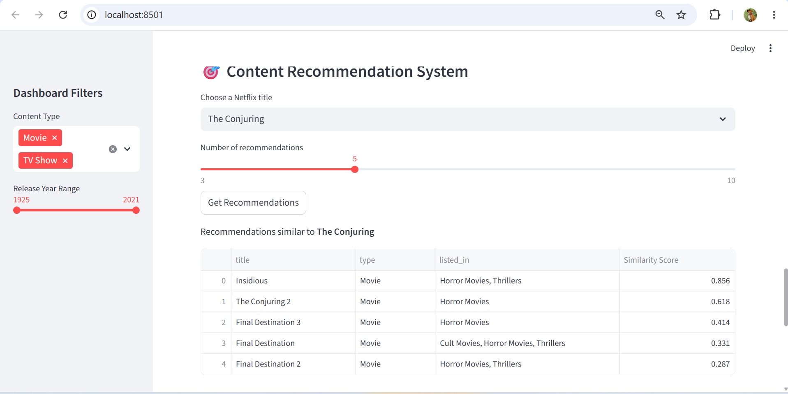

# Netflix Content Analytics and Recommendation System

## Project Overview

This project explores the Netflix content catalogue using data analysis, machine learning, time-series forecasting, and a content-based recommendation system.

The objective is to understand Netflix's content distribution, identify catalogue trends, recommend similar titles, and predict whether a title is a Movie or TV Show.

An interactive dashboard was developed using Streamlit to present the findings.


## Dashboard Preview

### 1. Dashboard Overview


### 2. Content Analysis


### 3. Trend Forecast


### 4. Content Recommendations



## Dataset

- Total records: 8,790
- Original features: 10
- Target platform: Netflix
- Dataset includes title, type, director, country, release year, rating, duration, and genres.

## Project Tasks

### 1. Data Cleaning and Preprocessing
- Handled missing and placeholder values.
- Standardized categorical values.
- Converted date columns into datetime format.
- Extracted year and month features.
- Extracted numerical duration and duration units.

### 2. Exploratory Data Analysis
- Analysed Movie and TV Show distribution.
- Identified top content-producing countries.
- Analysed popular genres.
- Examined content additions over time.

### 3. Content-Based Recommendation System
- Combined metadata such as content type, director, country, rating, and genres.
- Applied TF-IDF vectorization.
- Used cosine similarity to identify similar titles.
- Restricted recommendations to the same content type.

### 4. Trend Prediction
Evaluated:
- Linear Regression
- Random Forest
- ARIMA
- SARIMA

Compared models using MAE and RMSE.

ARIMA achieved the lowest MAE (33.03), while Random Forest achieved the lowest RMSE (40.78) on the selected test period.

The forecasts are exploratory and are based on historical data ending in September 2021.

### 5. Machine Learning Classification
Predicted whether a Netflix title is a Movie or TV Show.

Models evaluated:
- Logistic Regression
- Random Forest Classifier

**Best model: Logistic Regression**

- Accuracy: 99.09%
- Movie F1-score: 99.35%

The classification model includes preprocessing in its saved pipeline.

### 6. Interactive Dashboard
Developed using Streamlit.

Dashboard features:
- Catalogue KPIs
- Content distribution charts
- Country and genre analysis
- Content addition trends
- Monthly forecast
- Similar-title recommendations
- Model performance comparisons

## Technologies Used

- Python
- Pandas and NumPy
- Matplotlib and Seaborn
- Scikit-learn
- Statsmodels
- SciPy
- Joblib
- Streamlit
- Jupyter Notebook

## Project Structure

```text
Auspify_Netflix_Internship/
│
├── data/
│   ├── Dataset.csv
│   ├── netflix_cleaned.csv
│   ├── recommendation_data.csv
│   └── netflix_monthly_forecast.csv
│
├── dashboard/
│   └── app.py
│
├── models/
│   ├── tfidf_vectorizer.pkl
│   ├── tfidf_matrix.npz
│   ├── netflix_arima_model.pkl
│   ├── netflix_monthly_random_forest.pkl
│   └── netflix_type_classifier.pkl
│
├── notebooks/
│   └── Netflix_Internship_Project.ipynb
│
├── reports/
│   ├── classification_model_comparison.csv
│   ├── forecast_model_comparison.csv
│   └── monthly_model_comparison.csv
│
└── visualizations/
```

## How to Run the Project

### 1. Clone the repository

```bash
git clone YOUR_GITHUB_REPOSITORY_URL
```

### 2. Navigate to the project

```bash
cd Auspify_Netflix_Internship
```

### 3. Install dependencies

```bash
pip install -r requirements.txt
```

### 4. Launch the dashboard

```bash
python -m streamlit run dashboard/app.py
```

## Important Limitations

- The dataset is historical and ends in September 2021.
- Recommendations are based on metadata similarity, not individual viewing histories.
- Forecasts are exploratory and should not be interpreted as current Netflix catalogue predictions.
- Classification performance should be further validated using a chronological or external test dataset.

## Conclusion

This project demonstrates an end-to-end data science workflow, covering data preprocessing, exploratory analysis, recommendation systems, time-series forecasting, classification, and interactive dashboard development.
